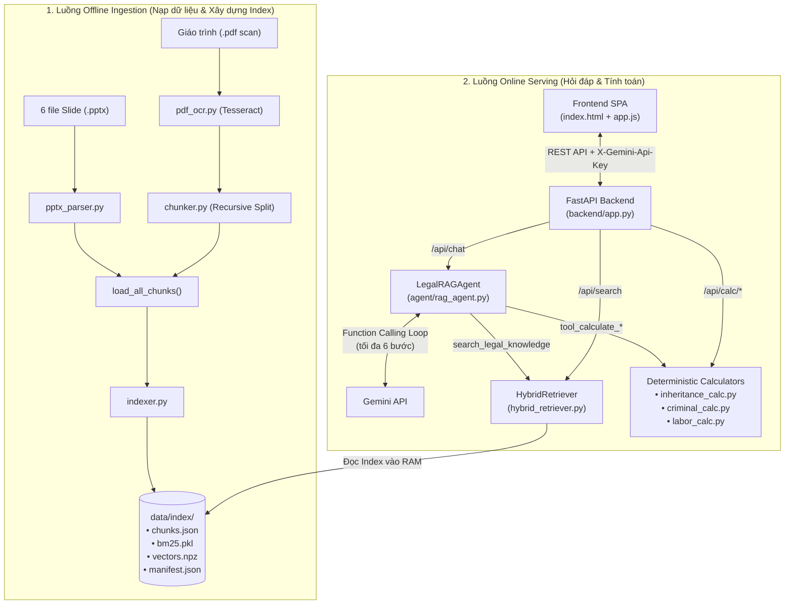

# Giải thích chi tiết kiến trúc, từng đoạn code và kỹ thuật trong `legal_rag`

Dự án **PLĐC Legal Agentic RAG** là một hệ thống trợ lý học tập và giải bài tập môn **Pháp luật Đại cương** kết hợp giữa **Hybrid RAG** (tra cứu tài liệu từ 6 bộ slide `.pptx` + giáo trình `.pdf` 248 trang) và **Deterministic Tool Calling** (gọi các bộ máy tính Python để tính toán chính xác 100% các bài tập thừa kế, hình sự, lao động thay vì để LLM tự tính nhẩm).

---

## 1. Cách các thành phần phối hợp với nhau (Kiến trúc tổng thể)

Hệ thống chia thành **2 luồng hoạt động độc lập** nhưng nối với nhau qua thư mục chỉ mục `legal_rag/data/index/`:

### Luồng chạy thực tế khi người dùng gửi một câu hỏi bài tập:
1. Người dùng gõ câu hỏi (ví dụ: *"Chia thừa kế bà Thủy - ông Tài 18 tỷ"*) trên [index.html](file:///Users/t1nt1n/Documents/HK261/PLDC/legal_rag/frontend/index.html) → [app.js](file:///Users/t1nt1n/Documents/HK261/PLDC/legal_rag/frontend/app.js) gửi `POST /api/chat` kèm lịch sử hội thoại, bộ lọc nguồn và chế độ truy xuất.
2. [app.py](file:///Users/t1nt1n/Documents/HK261/PLDC/legal_rag/backend/app.py) chuyển yêu cầu vào `agent.chat()` trong [rag_agent.py](file:///Users/t1nt1n/Documents/HK261/PLDC/legal_rag/agent/rag_agent.py).
3. `LegalRAGAgent` gửi `SYSTEM_INSTRUCTION` + lịch sử + khai báo 6 tools sang **Gemini API**.
4. Gemini phân tích đề bài và **không tự tính**, mà trả về yêu cầu gọi hàm (`function_call`):
   - Gọi `search_legal_knowledge` → chạy `HybridRetriever.search()` ([hybrid_retriever.py](file:///Users/t1nt1n/Documents/HK261/PLDC/legal_rag/retrieval/hybrid_retriever.py)) để tìm slide/giáo trình về Điều 644, 651 BLDS.
   - Gọi `tool_calculate_inheritance` với các tham số đã trích xuất từ đề bài → chạy `calculate_inheritance()` ([inheritance_calc.py](file:///Users/t1nt1n/Documents/HK261/PLDC/legal_rag/tools/inheritance_calc.py)) để tính ra từng con số và từng bước pháp lý.
5. `LegalRAGAgent` gửi kết quả của các tool ngược lại cho Gemini ở lượt tiếp theo của vòng lặp. Gemini tổng hợp thành bài giải chuẩn mực kèm trích dẫn `[Slide: ...]` / `[Giáo trình: ...]`.
6. Backend trả về JSON gồm `answer`, `citations`, `tool_trace`, `total_latency_ms` → Frontend render Markdown và hiển thị bảng **RAG & Tool Trace Inspector**.

---

## 2. Giải thích chi tiết từng file & đoạn code

### A. Cấu hình & Mô hình dữ liệu chuẩn

#### 1. [config.py](file:///Users/t1nt1n/Documents/HK261/PLDC/legal_rag/config.py)
- **Định vị đường dẫn động** ([L7-L15](file:///Users/t1nt1n/Documents/HK261/PLDC/legal_rag/config.py#L7-L15)): Dùng `Path(__file__).resolve().parent` để xác định `APP_DIR`, `DOCS_DIR` (thư mục cha chứa 6 file `.pptx` và 1 `.pdf`), và tự động tạo các thư mục `data/parsed`, `data/ocr_cache`, `data/index`.
- **Nạp biến môi trường** ([L18-L36](file:///Users/t1nt1n/Documents/HK261/PLDC/legal_rag/config.py#L18-L36)): Dùng `python-dotenv` nạp `.env`. Khai báo danh sách `GEMINI_FALLBACK_MODELS` để dự phòng khi model chính bị quá tải (503) hoặc không tồn tại (404), và cho phép chuyển đổi giữa `EMBEDDING_PROVIDER="local"` (ONNX cục bộ) hoặc `"gemini"`.
- **Tham số RAG mặc định** ([L39-L42](file:///Users/t1nt1n/Documents/HK261/PLDC/legal_rag/config.py#L39-L42)): `DEFAULT_TOP_K = 6`, `RRF_K = 60`, `TEXTBOOK_CHUNK_SIZE = 850`, `TEXTBOOK_CHUNK_OVERLAP = 150`.

#### 2. [ingestion/schemas.py](file:///Users/t1nt1n/Documents/HK261/PLDC/legal_rag/ingestion/schemas.py)
- Định nghĩa lớp Pydantic `DocumentChunk` ([L7-L22](file:///Users/t1nt1n/Documents/HK261/PLDC/legal_rag/ingestion/schemas.py#L7-L22)) làm đơn vị dữ liệu thống nhất cho cả Slide và Giáo trình (gồm `chunk_id`, `source_type`, `source_file`, `chapter`, `location_label`, `page_or_slide`, `title`, `text`, `metadata`).
- Phương thức `citation()` ([L19-L22](file:///Users/t1nt1n/Documents/HK261/PLDC/legal_rag/ingestion/schemas.py#L19-L22)) sinh nhãn trích dẫn chuẩn hóa dạng `[Slide: ... - Slide 45]` hoặc `[Giáo trình: ... - Trang 112]` để LLM gắn vào câu trả lời và Frontend nhận diện highlight.

---

### B. Pipeline nạp dữ liệu (`ingestion/`)

#### 3. [ingestion/pptx_parser.py](file:///Users/t1nt1n/Documents/HK261/PLDC/legal_rag/ingestion/pptx_parser.py) — Trích xuất 6 bộ Slide
- **Chuẩn hóa Unicode NFC** (`_normalize_str`, [L15-L16](file:///Users/t1nt1n/Documents/HK261/PLDC/legal_rag/ingestion/pptx_parser.py#L15-L16)): Rất quan trọng trên macOS vì hệ thống file macOS lưu tên file tiếng Việt ở dạng tổ hợp NFD; chuẩn hóa về NFC giúp so khớp tên chương và tìm kiếm từ khóa không bị lệch mã ký tự.
- **Suy luận chương học** (`_infer_chapter`, [L19-L34](file:///Users/t1nt1n/Documents/HK261/PLDC/legal_rag/ingestion/pptx_parser.py#L19-L34)): Ánh xạ tên file sang tên chương chuẩn (Dân sự, Thừa kế & HNGĐ, Lao động, Hình sự, Chương 1).
- **Trích xuất bảng & Group Shape đệ quy** ([L37-L88](file:///Users/t1nt1n/Documents/HK261/PLDC/legal_rag/ingestion/pptx_parser.py#L37-L88)):
  - `_extract_table_markdown` chuyển bảng PowerPoint sang bảng Markdown để giữ cấu trúc hàng/cột cho LLM đọc hiểu.
  - `_extract_shapes_text` đệ quy vào các shape bị nhóm (`shape.shape_type == 6`), đồng thời giữ mức thụt đầu dòng (`p.level`) và tách riêng tiêu đề (`title_shape_id`).
- **Đóng gói mỗi slide thành 1 chunk** (`parse_pptx_file`, [L91-L153](file:///Users/t1nt1n/Documents/HK261/PLDC/legal_rag/ingestion/pptx_parser.py#L91-L153)):
  - Lấy thêm **Speaker Notes** (`slide.notes_slide`) vì giảng viên hay ghi chú giải thích bài tập ở đây.
  - Bỏ qua các slide trang trí/chuyển chương ít chữ (`< 8` ký tự chữ cái, [L130-L132](file:///Users/t1nt1n/Documents/HK261/PLDC/legal_rag/ingestion/pptx_parser.py#L130-L132)).
  - Chèn dòng header `[Nguồn: Slide {idx} | {file_name} | {chapter}]` ngay đầu nội dung text.
- `parse_all_pptx()` ([L156-L172](file:///Users/t1nt1n/Documents/HK261/PLDC/legal_rag/ingestion/pptx_parser.py#L156-L172)) quét toàn bộ `.pptx` (bỏ qua file tạm `~$`), lưu ra `data/parsed/pptx_chunks.json`.

#### 4. [ingestion/pdf_ocr.py](file:///Users/t1nt1n/Documents/HK261/PLDC/legal_rag/ingestion/pdf_ocr.py) — OCR Giáo trình PDF 248 trang
- **Tự động tách trang đôi (Double-page Spread Split)** (`_ocr_single_pdf_page`, [L74-L139](file:///Users/t1nt1n/Documents/HK261/PLDC/legal_rag/ingestion/pdf_ocr.py#L74-L139)):
  - Kiểm tra tỷ lệ khung hình `w > h * 1.15`. Nếu là trang đôi scan ngang, code cắt thành 2 vùng `fitz.Rect` (trái/phải), đồng thời **cắt bỏ 2.5% mép ngoài và 1.5% gáy sách ở giữa** để loại bỏ bóng đen gáy sách gây nhiễu OCR và giữ đúng thứ tự đọc từ trái sang phải.
  - Render ảnh xám (`fitz.csGRAY`) ở độ phân giải `210 DPI` và gọi CLI `tesseract` cục bộ với gói ngôn ngữ chất lượng cao `tessdata_best/vie.traineddata` (`--psm 6`: coi mỗi nửa trang là một khối văn bản đồng nhất).
- **Hậu xử lý văn bản OCR** (`_clean_ocr_text`, [L38-L71](file:///Users/t1nt1n/Documents/HK261/PLDC/legal_rag/ingestion/pdf_ocr.py#L38-L71)):
  - Xóa ký tự rác ở đầu dòng do gáy sách (`|`, `[`, `]`, `I`, `!`).
  - Nối các từ bị gạch ngang ngắt dòng (`-\n`).
  - Ghép các dòng bị ngắt mềm trong cùng một đoạn văn lại với nhau, nhưng vẫn giữ nguyên xuống đoạn khi gặp `CHƯƠNG`, `Mục`, `1.`, `a)`, `Điều ...`.
- **Cache Resumable & Đa luồng** ([L82-L86](file:///Users/t1nt1n/Documents/HK261/PLDC/legal_rag/ingestion/pdf_ocr.py#L82-L86), [L174-L201](file:///Users/t1nt1n/Documents/HK261/PLDC/legal_rag/ingestion/pdf_ocr.py#L174-L201)):
  - Mỗi trang lưu cache riêng tại `data/ocr_cache/tess_pXXXX.json` → nếu dừng giữa chừng, chạy lại sẽ bỏ qua các trang đã xong.
  - Dùng `concurrent.futures.ThreadPoolExecutor` chạy song song nhiều tiến trình `tesseract`.
  - Sau khi xong tất cả các trang, duyệt theo thứ tự trang để kế thừa tên chương (`current_chapter`) cho các trang không in lại tiêu đề chương.

#### 5. [ingestion/chunker.py](file:///Users/t1nt1n/Documents/HK261/PLDC/legal_rag/ingestion/chunker.py) — Chia nhỏ Giáo trình
- **Chia đệ quy tôn trọng cấu trúc văn bản** (`_recursive_split`, [L13-L55](file:///Users/t1nt1n/Documents/HK261/PLDC/legal_rag/ingestion/chunker.py#L13-L55)):
  - Tách văn bản lớn theo thứ tự ưu tiên phân cách từ lớn đến nhỏ: `["\n## ", "\n### ", "\n\n", "\n", ". ", " "]` cho đến khi mọi mảnh nhỏ hơn `max_chars` (850 ký tự).
  - Ghép các mảnh liền kề vào cửa sổ `buf` sao cho không vượt `max_chars`, và khi đóng chunk thì giữ lại `overlap` (150 ký tự cuối) đưa sang đầu chunk tiếp theo để không làm đứt ngữ cảnh điều luật.
- `chunk_textbook_ocr()` ([L58-L112](file:///Users/t1nt1n/Documents/HK261/PLDC/legal_rag/ingestion/chunker.py#L58-L112)) tạo các `DocumentChunk` loại `"textbook"` lưu vào `textbook_chunks.json`.
- `load_all_chunks()` ([L115-L122](file:///Users/t1nt1n/Documents/HK261/PLDC/legal_rag/ingestion/chunker.py#L115-L122)) gộp chung cả `pptx_chunks.json` và `textbook_chunks.json`.

#### 6. [ingestion/indexer.py](file:///Users/t1nt1n/Documents/HK261/PLDC/legal_rag/ingestion/indexer.py) — Xây dựng Hybrid Index
- **Tokenizer chuyên biệt cho luật Việt Nam** (`tokenize_vietnamese_legal`, [L30-L55](file:///Users/t1nt1n/Documents/HK261/PLDC/legal_rag/ingestion/indexer.py#L30-L55)):
  - Bắt cụm tham chiếu pháp lý như `điều 644`, `khoản 1`, `chương 2` thành token ghép `dieu_644`, `khoan_1`, `chuong_2` để BM25 tìm chính xác điều luật thay vì khớp rời rạc chữ `"điều"` và số `"644"`.
  - Phát sinh **song song 2 dạng token**: giữ nguyên tiếng Việt có dấu (độ chính xác cao) + dạng bỏ dấu ASCII qua NFKD (tăng độ phủ khi người dùng gõ không dấu hoặc OCR sai dấu).
- **Dense Embedding 2 chế độ** ([L62-L157](file:///Users/t1nt1n/Documents/HK261/PLDC/legal_rag/ingestion/indexer.py#L62-L157)):
  - `_embed_chunks_local`: Chạy model ONNX lượng tử hóa `paraphrase-multilingual-MiniLM-L12-v2` qua thư viện `fastembed` hoàn toàn miễn phí, offline.
  - `_embed_chunks_gemini`: Gọi Gemini Embedding API theo batch 40 chunks, có cache dựa trên **SHA-256 hash** của nội dung (`_text_hash`) và cơ chế **retry backoff** khi gặp rate limit `429`.
  - Cả hai đều **chuẩn hóa L2** (`mat / norms`) để lúc truy vấn chỉ cần nhân ma trận (`vectors @ q_vec`) là ra ngay **Cosine Similarity**.
- `build_hybrid_index()` ([L160-L230](file:///Users/t1nt1n/Documents/HK261/PLDC/legal_rag/ingestion/indexer.py#L160-L230)) xuất 4 file: `chunks.json`, `bm25.pkl`, `vectors.npz` (nén), và `manifest.json`.

#### 7. [ingestion/run_pipeline.py](file:///Users/t1nt1n/Documents/HK261/PLDC/legal_rag/ingestion/run_pipeline.py)
- Script CLI (`argparse`) điều phối tuần tự 4 bước: `parse_all_pptx()` → (tùy chọn `--ocr-pdf`) `ocr_textbook_pdf()` → `chunk_textbook_ocr()` → `build_hybrid_index()`.

---

### C. Bộ truy xuất lai (`retrieval/`)

#### 8. [retrieval/hybrid_retriever.py](file:///Users/t1nt1n/Documents/HK261/PLDC/legal_rag/retrieval/hybrid_retriever.py)
- `reload()` ([L43-L64](file:///Users/t1nt1n/Documents/HK261/PLDC/legal_rag/retrieval/hybrid_retriever.py#L43-L64)): Nạp toàn bộ index vào RAM để truy vấn đạt độ trễ mili-giây; có thể gọi lại nóng (hot-reload) sau khi rebuild index.
- `_embed_query()` ([L74-L116](file:///Users/t1nt1n/Documents/HK261/PLDC/legal_rag/retrieval/hybrid_retriever.py#L74-L116)): Đọc `manifest.json` để tự động dùng đúng provider (`local` với lazy-load singleton `_local_embedder` hoặc `gemini` với `task_type="RETRIEVAL_QUERY"`) đã tạo ra `vectors.npz`.
- `search()` ([L118-L243](file:///Users/t1nt1n/Documents/HK261/PLDC/legal_rag/retrieval/hybrid_retriever.py#L118-L243)):
  1. **Lọc metadata trước** bằng NumPy boolean mask (`allowed_indices`) theo `source_type` (`all` / `slide` / `textbook`).
  2. **Chấm điểm BM25** trên toàn bộ corpus bằng `self.bm25.get_scores(q_tokens)`.
  3. **Chấm điểm Dense** bằng tích ma trận `self.vectors @ q_vec`. Nếu không có dense index hoặc lỗi API, tự động chuyển sang chế độ dự phòng (`bm25_fallback` / `bm25_only_no_dense_index`).
  4. **Xếp hạng & Hợp nhất RRF** ([L182-L209](file:///Users/t1nt1n/Documents/HK261/PLDC/legal_rag/retrieval/hybrid_retriever.py#L182-L209)):
     $$\text{Score}_{\text{RRF}}(d) = \frac{0.55}{60 + \text{rank}_{\text{dense}}(d)} + \frac{0.45}{60 + \text{rank}_{\text{bm25}}(d)}$$
  5. Trả về `top_k` kết quả kèm đầy đủ `bm25_rank`, `bm25_score`, `dense_rank`, `dense_score`, `final_score`, và `latency_ms`.

---

### D. Các công cụ tính toán pháp lý tất định (`tools/`)

Tất cả các file trong `tools/` đều nhận tham số có cấu trúc (đã kiểm kiểu bằng Pydantic/Literal), tính toán bằng logic Python thuần chính xác tuyệt đối, và trả về kèm mảng `steps` giải thích từng bước + `legal_basis` (điều luật căn cứ).

#### 9. [tools/inheritance_calc.py](file:///Users/t1nt1n/Documents/HK261/PLDC/legal_rag/tools/inheritance_calc.py) — Chia thừa kế (BLDS 2015)
- `WillBeneficiary` & `StatutoryHeir` ([L7-L44](file:///Users/t1nt1n/Documents/HK261/PLDC/legal_rag/tools/inheritance_calc.py#L7-L44)): Mô hình hóa người hưởng di chúc và người thuộc hàng thừa kế (có cờ `disinherited_by_will`, `refused_or_disqualified_621`, `predeceased_substitutes`).
- `_infer_forced_heir_644()` ([L47-L62](file:///Users/t1nt1n/Documents/HK261/PLDC/legal_rag/tools/inheritance_calc.py#L47-L62)): Tự động nhận diện diện Điều 644 (vợ, chồng, cha, mẹ, con chưa thành niên, con mất khả năng lao động) nếu LLM không truyền tường minh.
- `calculate_inheritance()` ([L65-L325](file:///Users/t1nt1n/Documents/HK261/PLDC/legal_rag/tools/inheritance_calc.py#L65-L325)) thực hiện đúng **4 bước chuẩn bài thi PLĐC**:
  - **Bước 1 — Di sản ròng** ([L85-L102](file:///Users/t1nt1n/Documents/HK261/PLDC/legal_rag/tools/inheritance_calc.py#L85-L102)): Chia đôi tài sản chung vợ chồng + tỷ lệ đồng sở hữu khác + tài sản riêng − nợ & mai táng phí.
  - **Bước 2 — Chia theo di chúc** ([L120-L167](file:///Users/t1nt1n/Documents/HK261/PLDC/legal_rag/tools/inheritance_calc.py#L120-L167)): Loại phần di chúc vô hiệu (chết trước/từ chối/Điều 621) để đẩy sang chia theo pháp luật; tự động scale tỷ lệ nếu tổng di chúc vượt quá di sản ròng.
  - **Bước 3 — Chia theo pháp luật & Thế vị** ([L169-L218](file:///Users/t1nt1n/Documents/HK261/PLDC/legal_rag/tools/inheritance_calc.py#L169-L218)): Phân biệt tinh tế giữa `hypothetical_heirs` (tính mẫu số 1 suất PL cho Điều 644 — **vẫn tính** người bị truất quyền, chỉ loại người từ chối/Điều 621) và `actual_intestate_heirs` (loại người bị truất quyền). Nếu có `predeceased_substitutes`, chia đều suất đó cho các cháu/chắt theo Điều 652.
  - **Bước 4 — Trích bù Điều 644** ([L220-L287](file:///Users/t1nt1n/Documents/HK261/PLDC/legal_rag/tools/inheritance_calc.py#L220-L287)): Tính mức tối thiểu `2/3` suất PL; nếu người diện Điều 644 nhận thiếu (`deficits`), tính phần dư khả dụng (`surpluses`) của những người nhận vượt sàn rồi trích giảm theo tỷ lệ để bù đủ.

#### 10. [tools/criminal_calc.py](file:///Users/t1nt1n/Documents/HK261/PLDC/legal_rag/tools/criminal_calc.py) — Hình sự (BLHS 2015)
- Chuẩn hóa toàn bộ thời gian về **tháng** (`1 năm = 12 tháng`, `1 tháng = 30 ngày`) và định dạng đẹp lại bằng `format_duration_months()` ([L11-L25](file:///Users/t1nt1n/Documents/HK261/PLDC/legal_rag/tools/criminal_calc.py#L11-L25)).
- `calculate_multi_crime_sentence()` ([L48-L182](file:///Users/t1nt1n/Documents/HK261/PLDC/legal_rag/tools/criminal_calc.py#L48-L182), **Điều 55 & 38**): Xử lý thứ bậc thu hút (`Tử hình` > `Chung thân` > `Tù có thời hạn` > `CTKGG`), quy đổi `3 ngày CTKGG = 1 ngày tù`, áp trần 30 năm tù / 3 năm CTKGG / 5 năm hình phạt bổ sung, trừ tạm giam (1:1 với tù, 1:3 với CTKGG), giữ phạt tiền & trục xuất độc lập.
- `calculate_multi_judgment_sentence()` ([L185-L278](file:///Users/t1nt1n/Documents/HK261/PLDC/legal_rag/tools/criminal_calc.py#L185-L278), **Điều 56**): Xử lý bẫy kinh điển trong đề thi:
  - `khoan_1_toi_cu` (**C: + −**): $\min(\text{BA1} + \text{BA2},\; 30\text{ năm}) - \text{đã chấp hành BA1}$.
  - `khoan_2_toi_moi` (**M: − +**): $\min((\text{BA1} - \text{đã chấp hành BA1}) + \text{BA2},\; 30\text{ năm})$.
- `calculate_suspended_sentence()` ([L281-L342](file:///Users/t1nt1n/Documents/HK261/PLDC/legal_rag/tools/criminal_calc.py#L281-L342), **Điều 65 & NQ 02/2018**): Kiểm tra toàn bộ điều kiện loại trừ (`disqualifiers`), tính thời gian thử thách = `2 × mức phạt tù` kẹp trong `[12, 60]` tháng.

#### 11. [tools/labor_calc.py](file:///Users/t1nt1n/Documents/HK261/PLDC/legal_rag/tools/labor_calc.py) — Lao động (BLLĐ 2019)
- `calculate_overtime_pay()` ([L7-L60](file:///Users/t1nt1n/Documents/HK261/PLDC/legal_rag/tools/labor_calc.py#L7-L60), **Điều 98 & NĐ 145/2020**): Tính hệ số làm thêm ban ngày (150%/200%/300%) và công thức ban đêm (`hệ số làm thêm + 30% + 20% × đơn giá ban ngày tương ứng`).
- `calculate_severance_allowance()` ([L63-L121](file:///Users/t1nt1n/Documents/HK261/PLDC/legal_rag/tools/labor_calc.py#L63-L121), **Điều 46, 47**): Trừ thời gian đóng BHTN, kiểm tra điều kiện đủ 12 tháng, làm tròn số năm (`1–6 tháng → 0.5 năm`, `>6 tháng → 1 năm`), áp mức sàn tối thiểu 2 tháng lương cho trợ cấp mất việc làm.
- `calculate_probation_rules()` ([L124-L152](file:///Users/t1nt1n/Documents/HK261/PLDC/legal_rag/tools/labor_calc.py#L124-L152), **Điều 25, 26**): Tra thời gian thử việc tối đa theo nhóm chức danh (180/60/30/6/0 ngày) và tính mức lương tối thiểu 85%.

---

### E. Bộ điều phối Agentic RAG (`agent/`)

#### 12. [agent/rag_agent.py](file:///Users/t1nt1n/Documents/HK261/PLDC/legal_rag/agent/rag_agent.py)
- **`SYSTEM_INSTRUCTION`** ([L24-L47](file:///Users/t1nt1n/Documents/HK261/PLDC/legal_rag/agent/rag_agent.py#L24-L47)): Đóng vai trò "hiến pháp" ép LLM luôn tra cứu tài liệu, ghi trích dẫn chuẩn, tuyệt đối không tính nhẩm, và nhắc các bẫy nghiệp vụ (con riêng không thuộc hàng 1, chia đôi tài sản chung vợ chồng, phân biệt K1 vs K2 Điều 56).
- **`_build_tool_declarations()`** ([L51-L297](file:///Users/t1nt1n/Documents/HK261/PLDC/legal_rag/agent/rag_agent.py#L51-L297)): Khai báo JSON Schema chi tiết (kiểu dữ liệu, enum, description) cho 6 tools để Gemini trích xuất đúng tham số từ câu hỏi tự nhiên.
- **`_execute_tool()`** ([L305-L393](file:///Users/t1nt1n/Documents/HK261/PLDC/legal_rag/agent/rag_agent.py#L305-L393)): Router điều hướng tên tool sang hàm Python tương ứng. Với `search_legal_knowledge`, nén gọn payload trả về LLM để tiết kiệm token nhưng vẫn giữ nguyên danh sách chunk đầy đủ để trả về cho Frontend.
- **`chat()`** ([L395-L535](file:///Users/t1nt1n/Documents/HK261/PLDC/legal_rag/agent/rag_agent.py#L395-L535)):
  - Giữ cửa sổ trượt **8 lượt hội thoại gần nhất** (`history[-8:]`) để kiểm soát context window.
  - Đặt `temperature=0.15` để câu trả lời pháp lý nhất quán, ít bịa đặt.
  - Chạy **Agentic Loop tối đa 6 bước** ([L442-L524](file:///Users/t1nt1n/Documents/HK261/PLDC/legal_rag/agent/rag_agent.py#L442-L524)): Mỗi bước gọi Gemini; nếu phản hồi chứa `function_call`, thực thi lần lượt từng tool, ghi log vào `tool_trace`, khử trùng lặp `citations` theo `chunk_id`, rồi đóng gói `Part.from_function_response` đưa lại vào `contents` cho vòng lặp kế tiếp. Khi không còn `function_call`, lấy `response.text` làm câu trả lời cuối.
  - **Auto Model Fallback & Promotion** ([L445-L463](file:///Users/t1nt1n/Documents/HK261/PLDC/legal_rag/agent/rag_agent.py#L445-L463)): Nếu model đang gọi báo `503`/`UNAVAILABLE`/`404`/`NOT_FOUND`, tự động thử model tiếp theo trong `GEMINI_FALLBACK_MODELS` và đẩy model hoạt động tốt lên đầu danh sách cho các bước sau.

---

### F. Backend & Frontend (`backend/`, `frontend/`)

#### 13. [backend/app.py](file:///Users/t1nt1n/Documents/HK261/PLDC/legal_rag/backend/app.py)
- Khởi tạo singleton `retriever = HybridRetriever()` và `agent = LegalRAGAgent(retriever=retriever)` ngay khi server khởi động ([L51-L52](file:///Users/t1nt1n/Documents/HK261/PLDC/legal_rag/backend/app.py#L51-L52)).
- Phục vụ file tĩnh giao diện tại `/` và `/static`.
- Cung cấp các REST API:
  - `GET /api/stats`: Báo cáo trạng thái index, tiến độ OCR (`tess_p*.json`), và trạng thái background job.
  - `POST /api/chat`: Nhận câu hỏi + `X-Gemini-Api-Key` header (ghi đè `.env` nếu người dùng tự nhập key trên web).
  - `POST /api/search`: Gọi thẳng `retriever.search()` cho tab kiểm tra truy xuất.
  - `POST /api/calc/*`: 5 endpoint gọi thẳng các hàm calculator không cần qua LLM.
  - `POST /api/index/rebuild`: Dùng `threading.Lock` (`_job_lock`) chống chạy trùng lặp và mở `threading.Thread(..., daemon=True)` chạy nền pipeline OCR/Indexing, xong thì gọi `retriever.reload()`.

#### 14. [frontend/index.html](file:///Users/t1nt1n/Documents/HK261/PLDC/legal_rag/frontend/index.html) & [frontend/app.js](file:///Users/t1nt1n/Documents/HK261/PLDC/legal_rag/frontend/app.js)
- Giao diện SPA thuần HTML/CSS/JS (không cần React/Vue hay CDN ngoài, chạy 100% offline) với 3 tab: **Chatbot Pháp luật**, **Máy tính Pháp lý** (có sẵn preset bài tập Slide 219, 220, 229), và **Kiểm tra Hybrid Retrieval**.
- **Bộ render Markdown an toàn tự viết** (`escapeHtml`, `renderInline`, `renderMarkdown`, [L9-L89](file:///Users/t1nt1n/Documents/HK261/PLDC/legal_rag/frontend/app.js#L9-L89)): Chống XSS trước khi parse bảng, tiêu đề, danh sách, và tự động biến thẻ `[Slide: ...]` / `[Giáo trình: ...]` thành badge nổi bật.
- **RAG & Tool Trace Inspector** (`buildTraceNode`, [L213-L249](file:///Users/t1nt1n/Documents/HK261/PLDC/legal_rag/frontend/app.js#L213-L249)): Hiển thị thẻ `
` có thể mở ra để xem chính xác LLM đã gọi tool nào, truyền tham số JSON gì, tốn bao nhiêu ms, và điểm BM25 vs Dense của từng đoạn tài liệu được truy xuất.
- **Polling trạng thái nền** (`refreshStats`, [L125-L171](file:///Users/t1nt1n/Documents/HK261/PLDC/legal_rag/frontend/app.js#L125-L171)): Tự động gọi lại `/api/stats` mỗi 3 giây khi đang chạy OCR/Rebuild để cập nhật thanh tiến trình.

---

### G. Kiểm thử & Đánh giá (`tests/`, `eval/`)

#### 15. [tests/test_calculators.py](file:///Users/t1nt1n/Documents/HK261/PLDC/legal_rag/tests/test_calculators.py) & [tests/test_api.py](file:///Users/t1nt1n/Documents/HK261/PLDC/legal_rag/tests/test_api.py)
- `test_calculators.py`: Kiểm thử đơn vị (Unit Test) đối chiếu kết quả của các hàm calculator với đáp án chuẩn trên các slide bài giảng (Slide 219, 220–221, 229, Slide 125 án treo, bẫy thi Điều 56 K1 vs K2).
- `test_api.py`: Kiểm thử tích hợp (Integration Test) dùng `FastAPI TestClient` để kiểm tra trang chủ, `/api/stats`, `/api/search` (BM25), và các endpoint `/api/calc/*`.

#### 16. [eval/eval_retrieval.py](file:///Users/t1nt1n/Documents/HK261/PLDC/legal_rag/eval/eval_retrieval.py)
- Đánh giá định lượng chất lượng bộ truy xuất trên tập `GOLDEN_SET` (8 câu hỏi chuẩn của môn PLĐC) qua 3 chỉ số chuẩn Information Retrieval:
  - **Recall@K**: Tỷ lệ câu hỏi tìm được đúng tài liệu mục tiêu nằm trong top K.
  - **MRR@K** (*Mean Reciprocal Rank*): Trung bình của $1/\text{rank}$ đầu tiên tìm thấy kết quả đúng (đo khả năng đẩy tài liệu đúng lên vị trí #1).
  - **Avg Latency**: Thời gian truy xuất trung bình (ms).

---

## 3. Tổng hợp các kỹ thuật cốt lõi được sử dụng

| Nhóm kỹ thuật | Kỹ thuật cụ thể | Giải quyết vấn đề gì? |
|---|---|---|
| **Retrieval (Truy xuất)** | **Hybrid Search (BM25 + Dense Vector)** | BM25 bắt chính xác từ khóa pháp lý (`Điều 644`, `85%`, `30 năm`), còn Dense Vector hiểu ngữ nghĩa đồng nghĩa/diễn đạt tự nhiên. Kết hợp cả hai khắc phục điểm yếu của từng nhánh. |
| **Ranking (Xếp hạng)** | **Weighted Reciprocal Rank Fusion (RRF)** | Điểm BM25 (không giới hạn trên) và Cosine Similarity (`[-1, 1]`) khác hẳn thang đo. RRF chỉ dựa vào **thứ hạng (`rank`)** nên hợp nhất cực kỳ ổn định mà không cần chuẩn hóa điểm phức tạp. |
| **NLP Tiếng Việt** | **Dual-Tokenization + Compound Legal Tokens + NFC** | Giữ đồng thời token có dấu & không dấu giúp chịu lỗi gõ thiếu dấu; gom `điều 644 → dieu_644` tránh nhiễu; chuẩn hóa NFC khắc phục lỗi lệch mã Unicode của macOS. |
| **Chunking** | **Recursive Structure-Aware Splitting + Overlap + Contextual Header** | Không cắt ngang giữa câu/đoạn; giữ overlap 150 ký tự chống đứt ý; gắn `[Nguồn: ...]` vào đầu mỗi chunk giúp cả BM25 lẫn Dense Embedding đều biết ngữ cảnh chương/slide. |
| **Agentic AI** | **ReAct Tool-Calling Loop + Deterministic Calculators** | LLM rất giỏi đọc hiểu đề bài tiếng Việt nhưng hay sai khi tính toán nhiều bước (chia phân số, áp trần 30 năm, bù 2/3 suất). Tách vai trò: **LLM trích xuất tham số & diễn giải**, **Python tính toán tất định 100%**. |
| **Tối ưu hiệu năng** | **Local ONNX Embedding (`fastembed`) + L2 Normalization** | Không tốn phí API & độ trễ mạng khi embed; chuẩn hóa sẵn vector đơn vị giúp tính Cosine Similarity toàn bộ corpus chỉ bằng 1 phép nhân ma trận `vectors @ q_vec` trong vài mili-giây. |
| **OCR & Data Engineering** | **Auto Spread-Splitting + Resumable Per-Page Cache + Multi-threading** | Sách giáo trình PDF scan 2 trang ngang nếu OCR nguyên trang sẽ bị đọc lẫn 2 cột. Cắt đôi + bỏ gáy sách + cache từng trang + chạy đa luồng giúp OCR nhanh, sạch và dừng/chạy tiếp an toàn. |
| **Độ tin cậy (Resilience)** | **Model Fallback & Promotion, Graceful Degradation, SHA-256 Cache, Exponential Backoff** | Hệ thống không sập khi model chính bị 503 (tự đổi model), khi mất API key/Dense index (tự lùi về BM25), hoặc khi gọi API bị rate-limit 429 (tự chờ và thử lại). |
| **Observability & QA** | **RAG & Tool Trace Inspector + Golden Set Eval (Recall@K, MRR@K)** | Minh bạch hóa hoàn toàn "hộp đen" của Agentic RAG cho người dùng/người chấm điểm xem từng tool call, điểm xếp hạng, và đo lường chất lượng truy xuất bằng số liệu thực tế. |
